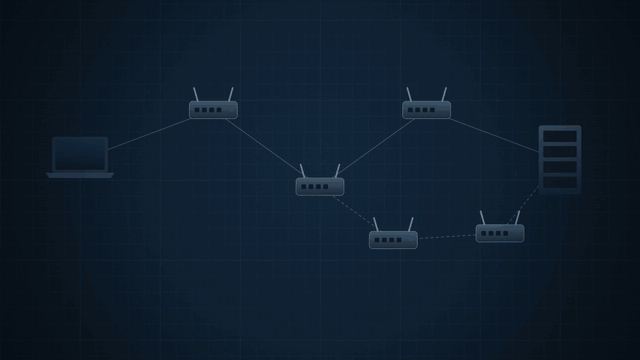

# vibe-explainer

全网大火的 Claude vibe 视频风格，我们这个项目就是专门针对这类视频做的 skill。

相较于其他把视频风格、时长都固定死的 skill，我们这个 skill 会根据视频内容和讲解内容，自动适配视频的时长和风格。
另外，默认没有背景音乐，只有音效；想要配乐，可以按自己的要求在后期剪辑时加上。



上面这段 15 秒的演示，就是用它做的（`examples/engine-tour/`）。

## 它和一般的"动画生成"有什么不同

- **先讲清楚，再画。** 每个概念先找一样外行认得的东西来演它，写好分镜表，才开始写画面代码。屏上的东西换给别的文案也成立的，算配图，不算讲解。
- **外观不套模板。** 每条片按题材、语气、屏上的主体和观看方式，现推一张"外观卡"：底色、颜色的含义、字体、字幕样式。横屏、竖屏都行。
- **时长不预设。** 分镜表写完，按字幕句数算出时长。只讲一件事几十秒，讲五六个侧面几分钟都可以。
- **改到看得懂为止。** 每一镜都截图检查；`render.py --check` 会自动查字幕会不会太长太快、有没有东西挡住字幕、同一帧渲两次是否一样，还会提醒音效太密的地方。
- **字幕是地道的中文讲解。** 像一个讲得好的老师当面在讲：一句接一句，因果说清楚，不跳步，也不写成电报体或翻译腔。
- **只有音效。** 没有配音，也没有背景音乐；音效用代码现场合成，跟着画面里的动作走：小动作一声轻的，关键那一下重的。想要背景音乐，拿成片到剪辑软件里自己加。

## 安装

需要 Python 3.10 以上、本机安装的 Google Chrome，以及 ffmpeg。

```bash
git clone https://github.com/blakeguo7/vibe-explainer.git ~/.claude/skills/vibe-explainer
cd ~/.claude/skills/vibe-explainer
pip install -r requirements.txt
python engine/get_fonts.py          # 下载开源字体（思源黑体、思源宋体等），约 45 MB
```

字体不放在仓库里，`get_fonts.py` 会从 Google Fonts 下载，它们各自使用 SIL Open Font License。

## 怎么用

装好以后，在 Claude Code 里直接说：

> 做一条讲数据库索引为什么快的视频

或者把一份文案、一页学习笔记交给它。它会按 `SKILL.md` 的流程走：立题和事实表、找形象、写分镜表并估时长、推外观卡、先做最难的一镜、做 30 秒样片，最后铺全片、合成音效。中间会停三次给你看：形象方案、分镜表加外观卡、样片。

## 目录

```
SKILL.md        流程：底线、外观怎么推、时长怎么算、每一步的过关标准
references/     讲解设计、字幕、外观、质检、引擎用法
looks/          三张推好的外观卡：暗场仪器、蓝图、纸面
engine/         引擎：ve.js（画面）、render.py（预览、渲染、检查）、audio.py（音效）
scripts/        建工程、估时长
examples/       演示片
```

## 许可

MIT，见 `LICENSE`。
